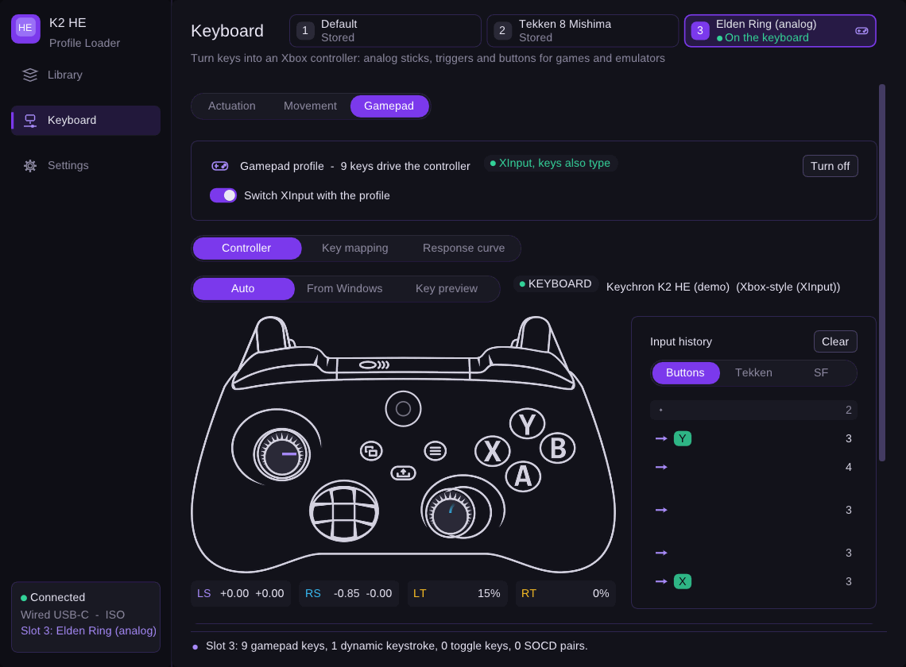
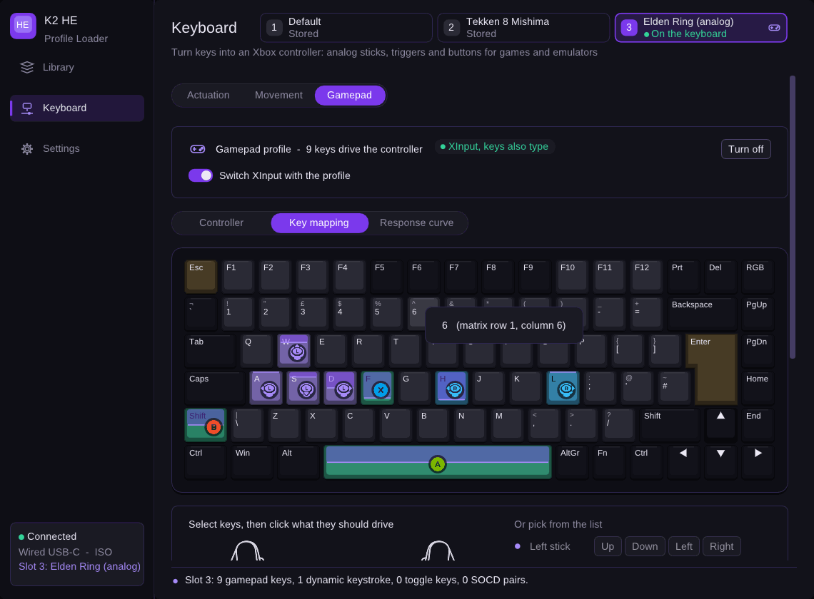
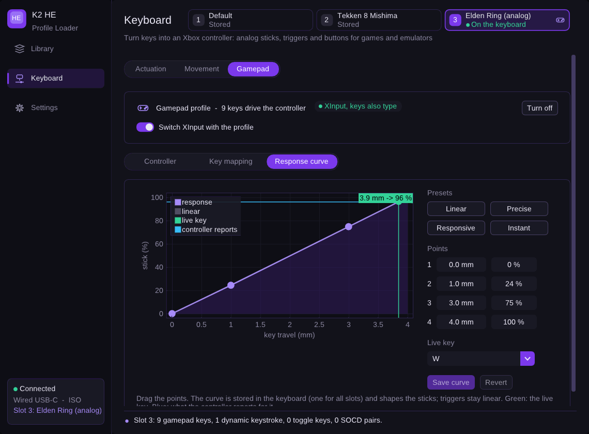
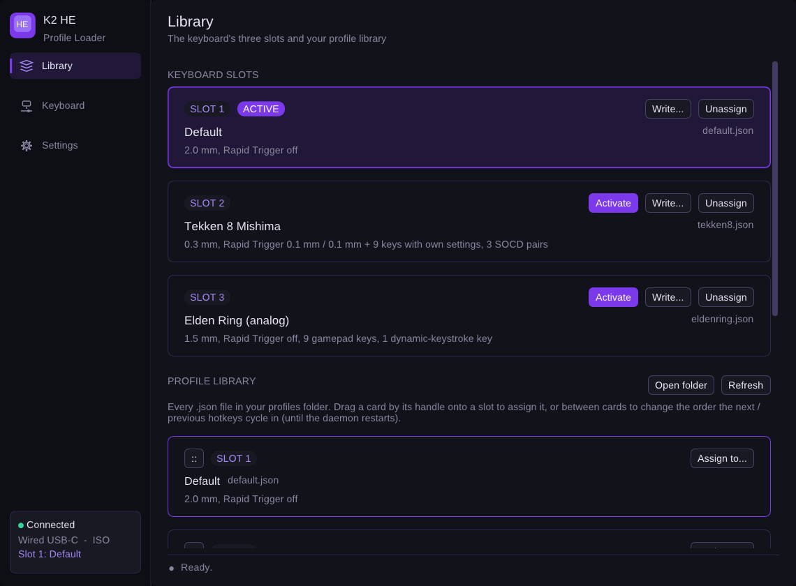
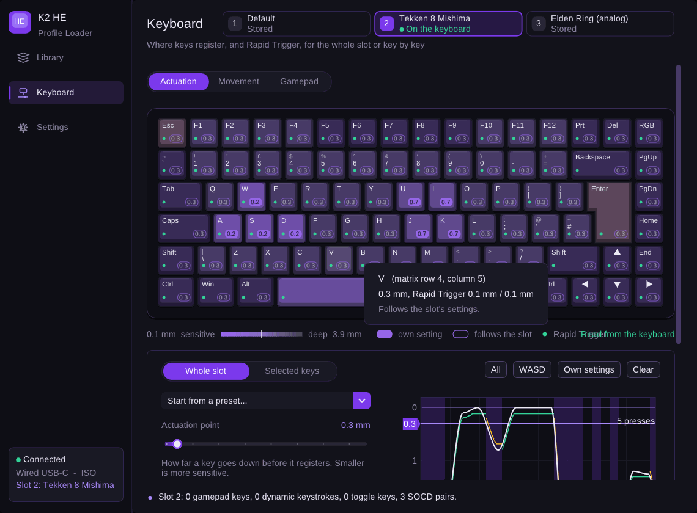
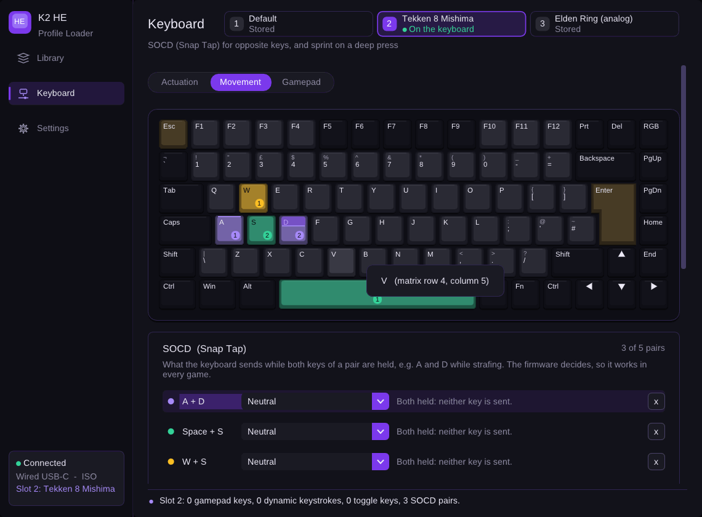
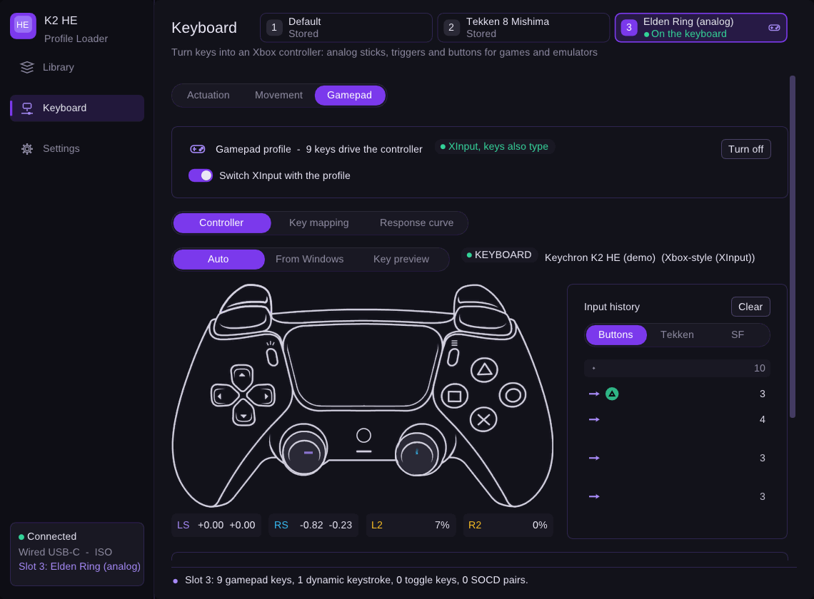

# KBD-Profile-Loader

A helper tray app for the **Keychron K2 HE** (Hall-effect keyboard running Keychron's open-source QMK
firmware). It lives in the system tray, switches between your profile `.json` files, and lets you tune
actuation / Rapid Trigger, SOCD, sprint-on-deep-press and the keyboard's built-in analog game controller
without opening a browser. Windows and Linux (Wayland **and** X11). The keyboard is configured over its
USB-C cable (wired only).

| Gamepad: live view | Gamepad: key mapping | Gamepad: response curve |
|---|---|---|
|  |  |  |

| Profiles | Actuation | Movement |
|---|---|---|
|  |  |  |

| Gamepad with PlayStation names (DualSense drawing) |
|---|
|  |

The default look is **black with purple as the secondary colour**, and every colour is
[easy to change](#theming).

## Features

- **System tray** on both OSes. Left click opens the dashboard, middle click switches to the next profile,
  the menu switches slots, opens your files and toggles *Run at startup*. The icon shows which of the three
  slots is active (see [`docs/screenshots/tray-icons.png`](docs/screenshots/tray-icons.png)).
- **Profiles tab**: one card per keyboard slot (*Activate*, *Write...*, *Unassign*) and a **library** of every
  profile file. Drag a library card by its handle onto a slot to assign it, or between cards to change the order
  the next / previous hotkeys cycle in. *Write...* sends the profile's global and per-key travel settings and
  its gamepad / toggle keys, SOCD pairs and name to the keyboard, saves them to flash and reads them back
  (with a confirmation first).
- **Layout**: the sidebar has three entries, *Library*, *Keyboard* and *Settings*. The Keyboard page edits one
  slot (switcher at the top, like the Launcher's profile list) with three tabs: Actuation, Movement, Gamepad.
- **Actuation tab**: a drawing of your K2 HE (ISO or ANSI, exact Keychron geometry) where every key shows the
  actuation point it really uses, tinted from sensitive to deep, with Rapid Trigger and per-key overrides marked.
  Select keys (click, Ctrl+click, drag a box, double-click for "same settings") and give them their own
  actuation point / Rapid Trigger, or hand them back to the slot. Below it the slot's global settings with
  presets. Every change is acknowledged by the keyboard and read back, and the result is shown in the status line.
- **Movement tab**: SOCD pairs (what happens while A and D are both held), named like the Launcher: Neutral,
  Last Key Priority, Rappy Snappy and Absolute Priority. Up to 5 pairs, with a test bench that runs the
  firmware's own SOCD logic on your live key presses (or a simulation) and **sprint on deep press**: a light press walks, pressing to the bottom also holds Shift (or another
  key). It is a dynamic keystroke stored in the slot, so it works in every game without the app running.
- **Gamepad page**: the K2 HE can be a real XInput (Xbox-style) controller whose sticks and triggers follow how
  far keys are pressed. *Live view* shows what Windows / Linux receives (through SDL3): sticks with trails and a
  deadzone preview, triggers, buttons, a stick circularity check, and a fighting-game **input history** in pad,
  Tekken (1 2 3 4) or Street Fighter notation with frame counts. *Key mapping* assigns keys to stick directions,
  triggers and buttons (presets: analog movement, twin stick, racing, full controller for emulators, arcade) and
  sets the controller mode (XInput or generic HID joystick, keys also type). *Response curve* drags the
  firmware's 4-point stick curve with the live key travel and the controller's real output drawn on top.
  Xbox or PlayStation button names, and button prompt glyphs on the mapped keys (Kenney or Zacksly, chosen in
  Settings).
- **Automatic gamepad mode**: switching to a slot with gamepad keys turns the keyboard's XInput mode on,
  switching to one without turns it off (from the app, the tray, a hotkey or Fn + P). The keyboard applies the
  new mode after its cable is replugged; a banner says so until it reconnects. Can be turned off on the
  Gamepad tab.
- **Settings page**: keyboard drawing (auto / ANSI / ISO), Xbox or PlayStation names, button prompt style,
  artwork credits, live theme editor, run-at-startup, shortcuts to the profiles folder / `config.ini` /
  `daemon.log`, device details.
- Navigation is a sidebar (Ctrl+1 .. Ctrl+3) with the keyboard's connection, layout (ANSI / ISO / JIS from
  its USB id) and active profile at the bottom.
- The UI never talks to the keyboard itself: all HID traffic runs on one background thread, so the window
  stays responsive and two transactions can never interleave.

## Building

Requirements: a C++20 compiler (GCC 11+, Clang 14+, MSVC 2022), CMake 3.25+, git. CMake downloads SDL3
3.4.20 (pinned, hash-checked), ImPlot 1.1 and GoogleTest on the first configure; to build offline pass
`-DFETCHCONTENT_SOURCE_DIR_SDL3=<path to an unpacked SDL3-3.4.20>`.

```bash
git clone --recurse-submodules https://github.com/mem64-bits/KBD-Profile-Loader.git
cd KBD-Profile-Loader            # (inside an existing clone: git submodule update --init)

cmake -S . -B build -G Ninja -DCMAKE_BUILD_TYPE=Release
cmake --build build
ctest --test-dir build --output-on-failure
```

Linux development packages (Debian / Ubuntu names; Arch: `base-devel cmake ninja wayland wayland-protocols
libxkbcommon libx11 libxrandr libxinerama libxcursor libxi libxext libdecor mesa glib2 systemd-libs`):

```bash
sudo apt install build-essential cmake ninja-build pkg-config libudev-dev libgl-dev \
    libwayland-dev wayland-protocols libxkbcommon-dev libdecor-0-dev libx11-dev libxext-dev \
    libxrandr-dev libxinerama-dev libxcursor-dev libxi-dev libxfixes-dev libglib2.0-dev
```

`libglib2.0-dev` (GIO) provides the Linux tray. Without it the build still succeeds, prints a warning and
runs without a tray icon (`-DKBD_ENABLE_SNI_TRAY=OFF` does the same on purpose). Windows needs nothing
beyond the compiler.

Linux also needs the udev rule so the daemon may open the keyboard's raw HID endpoint
(`packaging/99-keychron-rules.rules`, installed by `cmake --install` / the PKGBUILD) and optionally the
user service `packaging/kbd_daemon.service`.

When you add or remove source files, run `python3 sync_cmake.py` to refresh the file lists in
`CMakeLists.txt`.

## Using it

### The tray

| Action | Result |
|---|---|
| Left click | show / hide the dashboard |
| Middle click | next profile |
| Right click | menu (drawn by Windows or by your desktop): slots, next / previous, open dashboard, profiles folder, `config.ini`, `daemon.log`, *Run at startup*, *Exit* |

Closing the dashboard window only hides it; the daemon keeps running. If no tray is available the daemon
shows the dashboard at start-up and the close button quits instead.

**Linux tray hosts.** The tray uses the StatusNotifierItem protocol, which is identical on Wayland and X11:

| Desktop | Tray |
|---|---|
| KDE Plasma | works out of the box |
| GNOME | install the *AppIndicator and KStatusNotifierItem Support* extension |
| Sway, Hyprland, ... | use a bar with a tray module, for example waybar's `tray` |

The icon appears as soon as a host is running, even if the daemon was started first. On GNOME/Wayland also
install a `libdecor` plugin (for example `libdecor-0-plugin-1-gtk`), otherwise SDL cannot draw a title bar.

### Command line

```text
KBD_Profile_Loader [--debug | --silent] [--show] [--demo] [--screenshot <file.png>] [--tab <name>] [--slot <1-3>]

  --show               open the dashboard at start-up (or in an already running daemon)
  --demo               run the UI against a simulated keyboard and controller: preview without hardware
  --screenshot <file>  with --demo: render the dashboard to a PNG and exit
  --tab <name>         first page: profiles, actuation, movement, gamepad, gamepad-mapping, gamepad-curve, settings
  --slot <1-3>         with --demo: the slot the simulated keyboard starts on
  --labels <style>     xbox or playstation button names (playstation also shows the DualSense drawing)
  --size <WxH>         window size in logical pixels
```

Linux also has commands for a running daemon, sent over `/tmp/kbd_daemon.sock`, meant for compositor
shortcuts (Wayland has no global hotkeys):

```text
KBD_Profile_Loader --next | --prev | --slot1 | --slot2 | --slot3 | --toggle | --show | --hide
```

```text
# sway
bindsym $mod+bracketright exec KBD_Profile_Loader --next
bindsym $mod+bracketleft  exec KBD_Profile_Loader --prev

# Hyprland
bind = SUPER, bracketright, exec, KBD_Profile_Loader --next
bind = SUPER, bracketleft,  exec, KBD_Profile_Loader --prev
```

On Windows the hotkeys from `config.ini` (`next_profile`, `prev_profile`) are registered as before.

### Profile files

Every `.json` file in `~/Documents/Keychron Profiles` is a profile (the folder is watched; new files appear
without a restart). A file has a `name`, optionally the slot it belongs to (`current`, 0 - 2; without it the
file is "library only") and its settings in one of these forms:

- A Keychron Launcher export (`HEProfile-<name>-<date>.json`, shown as `<name>`): `global`, `keyMatrix` (rows
  of keys with `mode`, `distance`, `advance_press`, `advance_release` in 0.1 mm, 0 = "use the global value"),
  gamepad / toggle keys and `snapTap` SOCD pairs.
- The keyboard's 860-byte profile as `memory` (array of numbers) or `raw_hex` (hex string), laid out like the
  firmware's `analog_matrix_profile_t` (see [`docs/FIRMWARE_NOTES.md`](docs/FIRMWARE_NOTES.md)).

A slot holds one file: assigning a file to a slot (in the Profiles tab) writes its `current` field and removes
it from the file that had the slot before.

## Theming

`theme.json` lives next to `config.ini` (`%APPDATA%\KBD_Profile_Loader\` on Windows,
`~/.config/KBD_Profile_Loader/` on Linux) and is created with the defaults on first start. Edit it with any
editor: **changes apply live**, no restart. Or use the *Settings* tab and press *Save theme.json*.
Every key is optional; a file that only sets `accent` is complete (hover and pressed shades are derived).

```json
{
  "name": "Black & Purple",
  "fontFile": "",
  "colors": {
    "background":    "#0A0A0F",
    "surface":       "#12121A",
    "surfaceRaised": "#1B1B26",
    "border":        "#2E2650",
    "text":          "#ECEAF5",
    "textMuted":     "#8C88A3",
    "textOnAccent":  "#FFFFFF",
    "accent":        "#7C3AED",
    "accentHover":   "#8B5CF6",
    "accentActive":  "#6D28D9",
    "accentText":    "#A78BFA",
    "success":       "#34D399",
    "warning":       "#FBBF24",
    "danger":        "#F87171"
  },
  "metrics": {
    "windowRounding": 10, "frameRounding": 6, "popupRounding": 8, "tabRounding": 6,
    "scrollbarRounding": 9, "windowBorderSize": 1, "frameBorderSize": 0,
    "windowPaddingX": 16, "windowPaddingY": 14, "framePaddingX": 10, "framePaddingY": 6,
    "itemSpacingX": 10, "itemSpacingY": 9, "fontSize": 16
  }
}
```

Colours are `#RGB`, `#RRGGBB` or `#RRGGBBAA`. Mistakes (unknown keys, bad colours, out-of-range sizes) are
reported in `daemon.log` and ignored; the rest of the file still applies. `fontFile` can point to any `.ttf`;
when empty the system UI font is used (Segoe UI on Windows, Noto / Liberation / DejaVu Sans on Linux) and
ImGui's built-in font as a last resort; no font is bundled. The built-in tray icon is drawn in the same
colours. The Windows tray *menu* is the native Windows menu and follows the system theme.

To change the built-in defaults themselves, edit the values in `headers/ui/Theme.h` (one place).

## How it is put together

All UI code is in namespace `ui`; hardware code stays in `kbd`, files in `Files`.

```text
 tray click, menu ──▶ TrayPresenter ──▶ ITrayIcon ─┬─ Win32TrayIcon   (Shell_NotifyIcon)
 (Observer of AppModel + Theme)                    ├─ SniTrayIcon     (D-Bus StatusNotifierItem + dbusmenu, GIO)
        │                                          └─ NullTrayIcon    (headless)
        │ IProfileCommands
 ImGui views ───────────────┤      UIManager = SDL3 + OpenGL + Dear ImGui (Win32 / X11 / Wayland)
 (sidebar pages)            │      SdlGamepadSource ─▶ IGamepadSource (live controller input, UI thread)
 hotkeys, IPC ──────────────┘
                            ▼
                    ProfileController      one worker thread + queue, also observes the file / device watchers
                            │ IProfileGateway   (port)
                            ▼
                ProfileServiceGateway      (adapter: ack-checked commands, read-back)
                            ▼
                kbd::ProfileService ─▶ KeyboardDevice (HID)         results ─▶ AppModel (immutable AppSnapshot)
```

Patterns: **Observer** (`IFileObserver`, `IDeviceObserver`, `IThemeObserver`, `IAppModelObserver`,
`ITrayObserver`, all on the thread-safe `ui::ObserverList`), **Singleton** (`ui::ThemeManager`, like
`Files::Logger`), **Adapter / ports** (`IProfileGateway`, `ISystemIntegration`, `IWindowController`),
**Presenter** (`TrayPresenter`), pimpl for every class that would otherwise drag `windows.h`, SDL or GIO
into a header. Classes own their special members explicitly (rule of five). Platform code is isolated in
`*Win32*.cpp` / `*Posix*.cpp` / `SniTrayIcon.cpp`; headers are OS-agnostic.

**Adding a tray backend**: derive from `ui::TrayIconBase`, draw the cached state in `onStateChanged()`, call
`notifyActivated()` / `notifyMenuItemSelected()`, and return it from `ui::createTrayIcon()`.
**Adding a page**: implement `ui::IPanel` (title, subtitle, sidebar icon, render) and `addPanel()` it in `main.cpp`.

**Game controller**: `ui::gamepad::IGamepadSource` is the port (SDL3 in the app, `DemoGamepadSource` for `--demo`);
`GamepadModel` (input history, numpad notation, stick trail, circularity test) and `ControllerMapping` (targets,
presets, SOCD modes, keycodes) are plain C++ and unit-tested. Live key travel comes from the keyboard
(`AMC_GET_REALTIME_TRAVEL`), polled by the controller's worker only while a page watches keys.

**Keyboard drawing**: `ui::KeyboardLayout` holds the K2 HE's ISO and ANSI layouts (matrix position, x / y / w / h
in key units, legends), generated from Keychron's QMK `keyboard.json` and VIA files. `ui::KeyboardView` draws
any such layout with the ImGui draw list (no textures or third-party artwork) and handles selection; the
Actuation tab feeds it the per-key values from the `AppSnapshot`.

## Testing and status

`ctest` runs the GoogleTest suite (theme, models, controller, tray menu and presenter, icon renderer, firmware
bit and profile layouts, per-key packets, the keyboard layouts, the profile library, the gateway against a
dry-run keyboard, the D-Bus tray against a private bus, autostart, ...) and a UI smoke test that starts the app against the simulated keyboard on a
virtual display and checks that a screenshot is written. On Windows, five more tests cover the tray window and
the Startup shortcut.

Verified during development:

- Linux: GCC 13 and Clang 18, AddressSanitizer + UBSan clean, ThreadSanitizer clean (apart from false
  positives inside GLib), X11 (Xvfb) and a real Wayland compositor (headless weston), the D-Bus tray against
  a private session bus and a stand-in tray host, and the running daemon driven through tray / IPC calls.
- Windows: cross-compiled with MinGW-w64, the unit tests run under Wine (including the Windows-only branches
  of the existing tests and the new tray / Startup-shortcut tests), and the daemon starts under Wine, creates
  its tray icon and shuts down cleanly.

Known limits:

- Profile files are noticed when they are added or removed, not when edited in place (that is how the
  existing `DirectoryWatcher` works); restart the daemon after editing a profile.
- Wayland does not let a program place its own windows, so the dashboard opens wherever the compositor puts it.
- Linux has no global hotkeys (a Wayland rule); use the `--next` / `--prev` / `--slotN` commands from
  compositor shortcuts.
- Edits made on the Actuation / Movement / Gamepad pages change the keyboard's slot, not the profile file;
  writing the file to the slot again replaces them. Toggle keys and calibration have no editor yet, and only the
  "sprint" shape of dynamic keystrokes can be edited (others are kept and shown).
- The controller mode and the response curve are keyboard-wide; a new controller mode takes effect after the
  cable is unplugged and plugged back in.
- The library order you set by dragging lasts until the daemon restarts (then files are sorted by slot).
- Wired only: the K2 HE is opened over USB-C (PIDs `0x0E20` ANSI, `0x0E21` ISO, `0x0E22` JIS). Lighting is left
  to OpenRGB / the Keychron Launcher.

**Not verified**: a real keyboard (including the controller as seen by SDL3 and the live travel rate), a native
Windows / MSVC build, and real desktop tray hosts (Plasma, the
GNOME extension, waybar). Please try those. The protocol behaviour the UI depends on is summarised in
[`docs/FIRMWARE_NOTES.md`](docs/FIRMWARE_NOTES.md), checked against Keychron's firmware source; the UI reads
every change back and *shows* any difference on real hardware instead of hiding it.

## Artwork and credits

- Controller drawing: the "xbox-controller" preset from [input-overlay](https://github.com/univrsal/input-overlay)
  by Saikel Orado Liu, CC0 1.0, with the Xbox logo removed (`assets/controller/`).
- DualSense drawing (used with PlayStation button names): the "dualsense" preset from input-overlay by Caro, made
  from [Xelu's free controller prompts](https://thoseawesomeguys.com/prompts/), CC0 1.0, with the PlayStation
  logos removed (`assets/controller/`, rebuilt by `tools/make_dualsense_atlas.py`).
- Button prompts: [Input Prompts](https://kenney.nl/assets/input-prompts) by Kenney, CC0 1.0
  (`assets/glyphs/`, licence file included).
- Xbox Series Button Icons and Controls - Zacksly. Licensed under
  [CC BY 3.0](https://creativecommons.org/licenses/by/3.0/) - https://zacksly.itch.io
- PS5 Button Icons and Controls - Zacksly. Licensed under
  [CC BY 3.0](https://creativecommons.org/licenses/by/3.0/) - https://zacksly.itch.io
- Both Zacksly sets are modified: the "Buttons Full Solid" icons were resized and packed into
  `assets/glyphs/zacksly-prompts.png` (row 1 Xbox, row 2 PS5), and the app tints them
  (`assets/glyphs/ZACKSLY_LICENSE.txt`, `ZACKSLY_PS5_LICENSE.txt`).
- Xbox and PlayStation are trademarks of their owners; the names only say which buttons are meant. No code
  or artwork from the Keychron Launcher is used.
